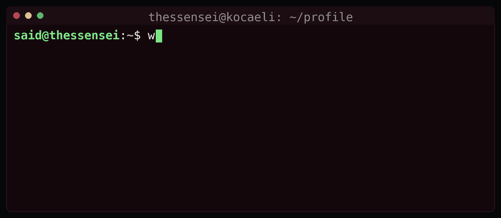

<h1>Hi, I'm Muhammet Said <code>(thessensei)</code></h1>

 

---

## 👤 About Me

I stepped into the internals of computer systems, hardware architectures and the raw power of code at 14–15. Instead of gluing together ready-made plugins or drag-and-drop systems, I build with pure terminal commands, hardware-accelerated scripts and tuned database layers.

|  |  |
| :--- | :--- |
| 🚀 **Role** | Systems & Embedded Software Developer Candidate |
| 📍 **Location** | Kocaeli, Türkiye |
| 🎂 **Age / Experience** | **17** — actively coding since **14** |
| 🎯 **Core Focus** | Autonomous UAV/Avionics · Hardware-Accelerated Media · Cyber Defense |
| 💼 **Currently** | Cyber Security & IT Infrastructure Management Intern |

---

## 🖥️ Terminal

  

---

## 🛠️ Tech Stack

 

 

---

## 🎯 Technical Focus

### 🛸 Embedded Systems & Autonomous Aviation
- **UAV architecture:** compiling and optimizing open-source robotics frameworks (`ArduPilot`, `PX4`) on Pixhawk / STM32-based flight controllers.
- **Robotics simulation:** building autonomous flight algorithms on `ROS` + `Gazebo` inside isolated Linux (Ubuntu/Debian) environments.
- **Model rocketry & telemetry:** avionics flight computers for solid/liquid-fueled rockets, streaming real-time IMU, barometer and GPS arrays to ground control stations.

### 🎬 Hardware-Accelerated Media
- Locking directly into NVIDIA `CUDA / NVENC` filter graphs for zero-GUI, high-volume batch encoding.
- Building localization pipelines that run unattended end-to-end — no timeline, no render farm, just ffmpeg graphs and GPU.

### 🔒 Cyber Defense & Infrastructure
- Non-blocking network reconnaissance (`asyncio`) for port probing and corporate subnet auditing.
- Hardening Windows/Linux endpoints, network segmentation and log-driven monitoring while interning in IT infrastructure.

---

## 📦 Featured Projects

| Project | Stack | What it does |
| :--- | :--- | :--- |
| **[KuaforRandevuSistemi](https://github.com/thessensei/KuaforRandevuSistemi)** | `C#` `WinForms` `MySQL` | Desktop appointment automation backed by an asynchronous relational DB layer executing clean CRUD transactions |
| **[nvenc-anime-pipeline](https://github.com/thessensei/nvenc-anime-pipeline)** | `CUDA` `NVENC` `Batchfile` | Zero-GUI batch encoder for media localization pipelines — up to **30x encoding speeds** |
| **[async-network-scanner](https://github.com/thessensei/async-network-scanner)** | `Python` `asyncio` | High-performance non-blocking port probing and subnet security auditing |
| **[HastaneOtomasyon](https://github.com/thessensei/HastaneOtomasyon)** | `C#` `MySQL` | Hospital automation — patient, appointment and record management |
| **[LibraryOtomasyon](https://github.com/thessensei/LibraryOtomasyon)** | `C#` `MySQL` | Library management system with member, lending and inventory tracking |

---

## 📊 GitHub Stats

 

 

---

**“Build it from the terminal.”** 🔍

UAV · Avionics · CUDA pipelines · Cyber defense — from Kocaeli, Türkiye

